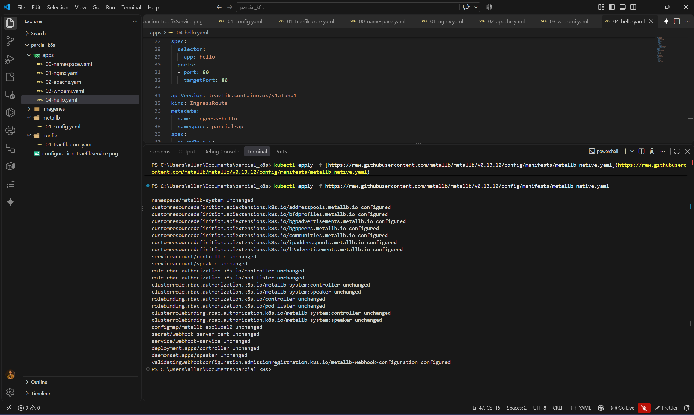
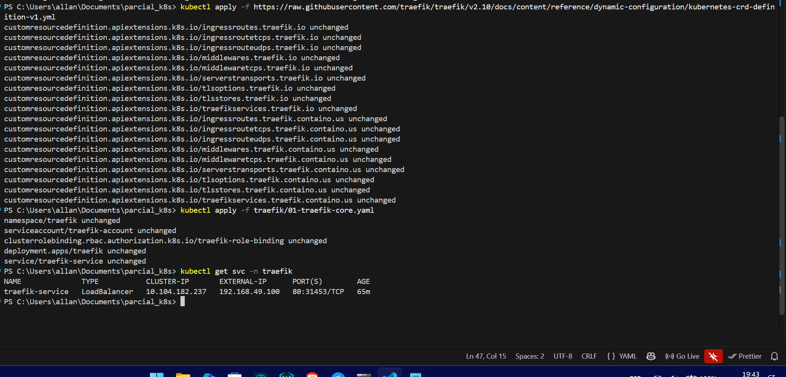
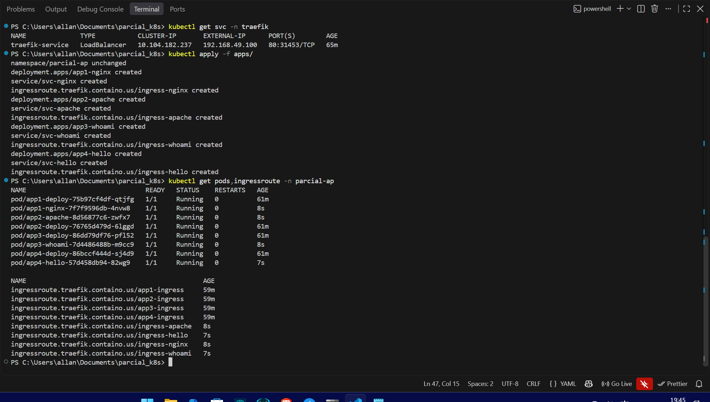
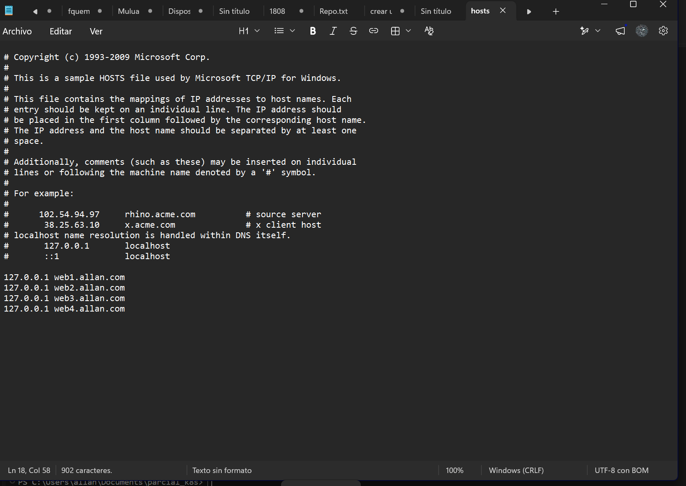
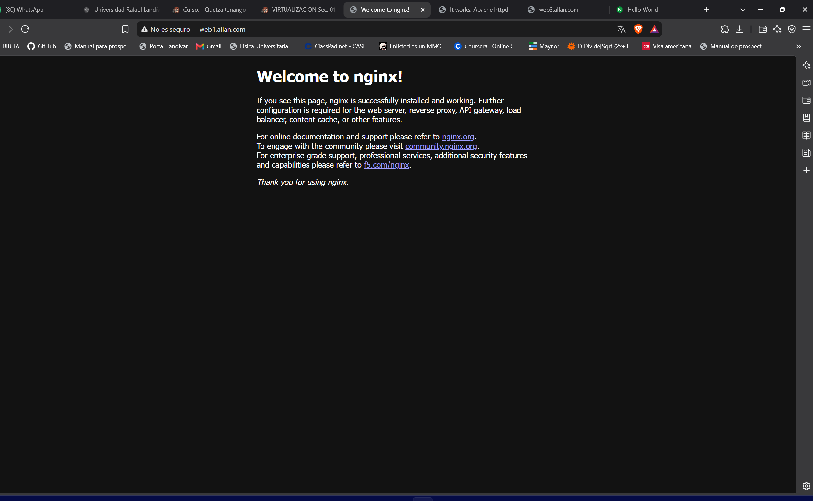
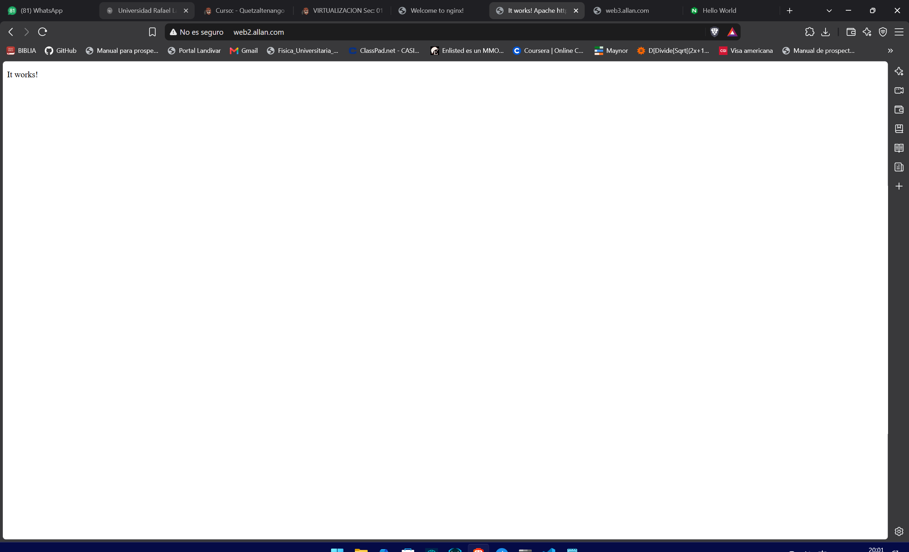
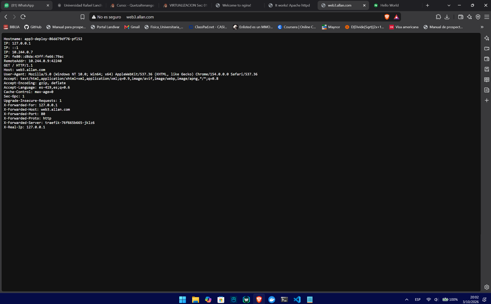
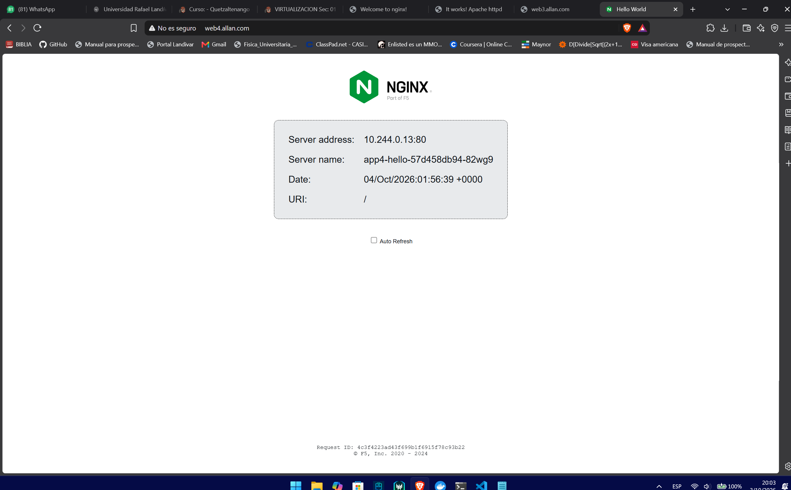

# Evaluación Parcial 02 - Traefik, MetalLB y Kubernetes

Implementación de un clúster local en Minikube utilizando arquitectura modular de Infraestructura como Código (IaC). Se configuró **MetalLB** para la asignación de IPs públicas y **Traefik** como Ingress Controller (LoadBalancer) para el enrutamiento de múltiples aplicaciones web bajo un único punto de entrada.

## 1. Estructura del Proyecto
El proyecto se dividió en manifiestos independientes para mantener una arquitectura limpia:
- `/metallb/`: Manifiestos para el pool de IPs (`192.168.49.100-192.168.49.120`).
- `/traefik/`: Configuración del LoadBalancer, ServiceAccounts y roles.
- `/apps/`: Despliegues, Servicios y reglas IngressRoute encapsuladas por aplicación.

## 2. Configuración de MetalLB y Traefik
Los pods del controlador de MetalLB se ejecutaron correctamente en su namespace dedicado:

Traefik fue desplegado obteniendo exitosamente la IP pública asignada por MetalLB (`192.168.49.100`):

## 3. Despliegue de Aplicaciones (Namespace: `parcial-ap`)
Se generaron 4 aplicaciones web distintas (Nginx, Apache, Whoami, Hello Web). Cada aplicación cuenta con su propio Deployment, Service y regla de IngressRoute para conectar el dominio con Traefik.

## 4. Resolución DNS y Conexión
Debido a la naturaleza de virtualización de red en entornos Windows, se actualizó el archivo local de Hosts para resolver los dominios personalizados:

## 5. Evidencias de Acceso por Dominio
Resultados de las peticiones HTTP gestionadas por Traefik:

### Web 1: Nginx (`web1.allan.com`)

### Web 2: Apache (`web2.allan.com`)

### Web 3: Whoami (`web3.allan.com`)

### Web 4: Hello Web (`web4.allan.com`)
