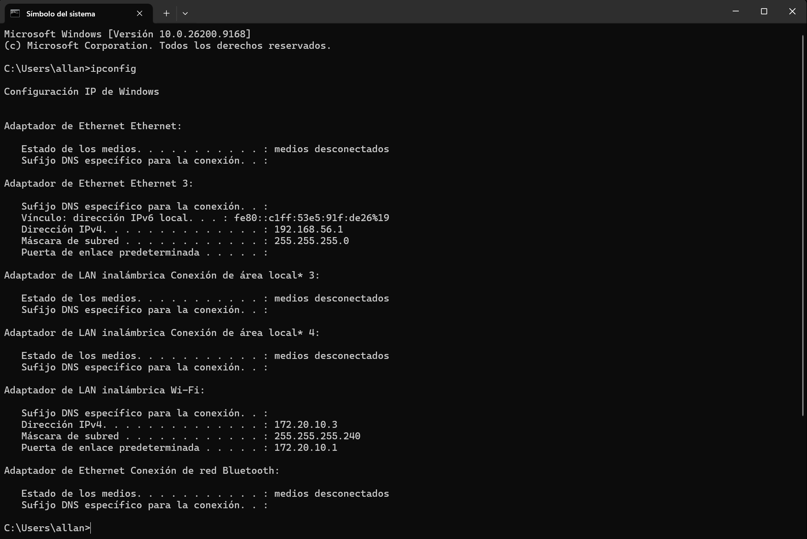
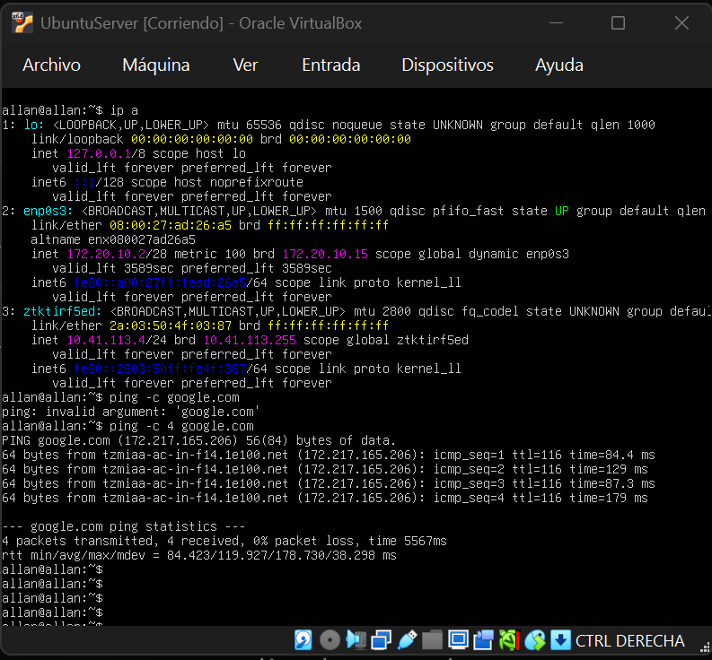
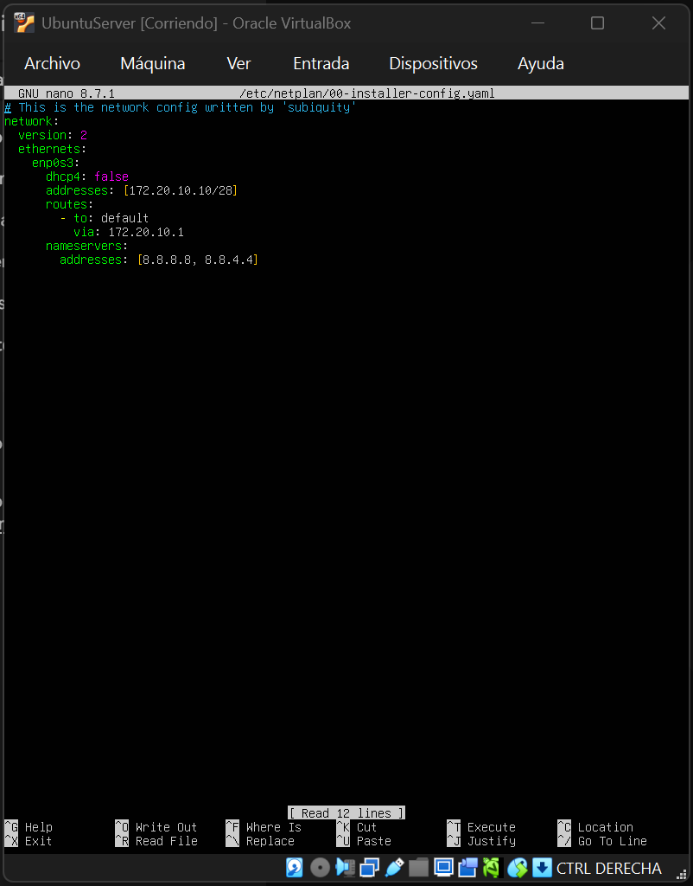
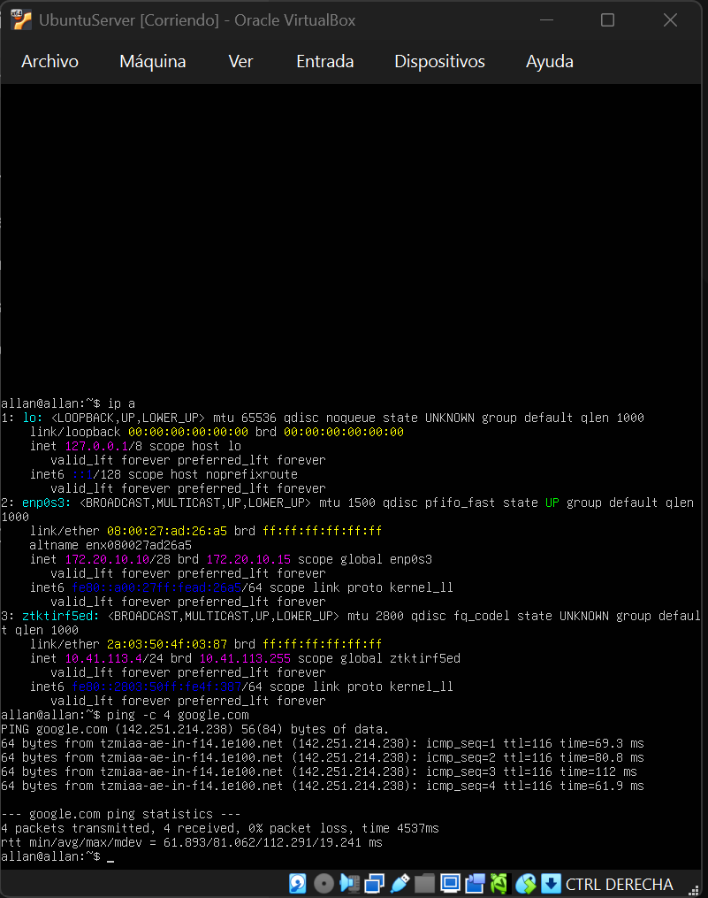
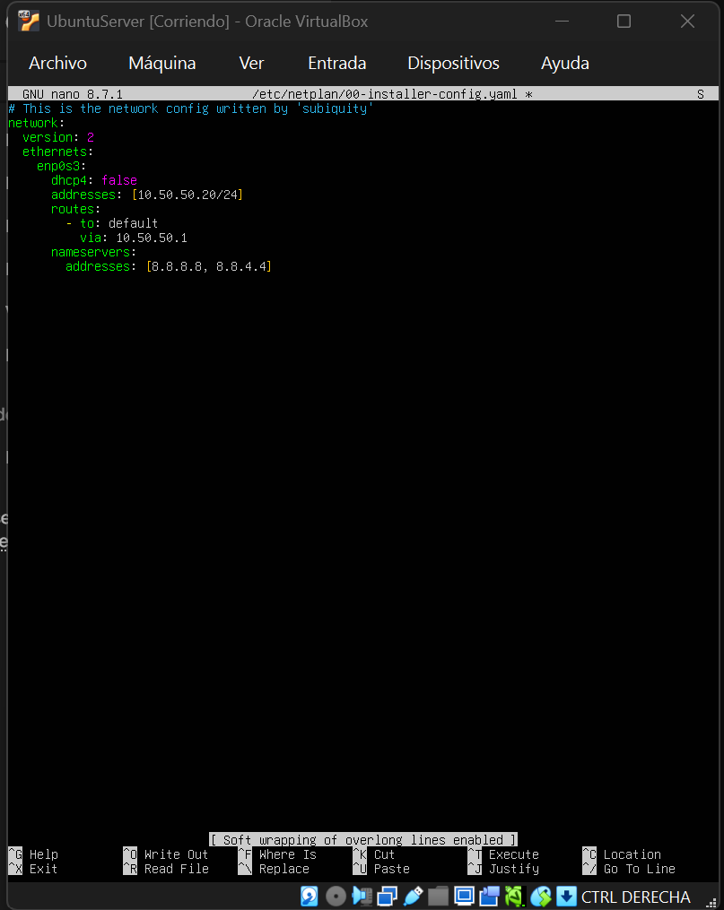
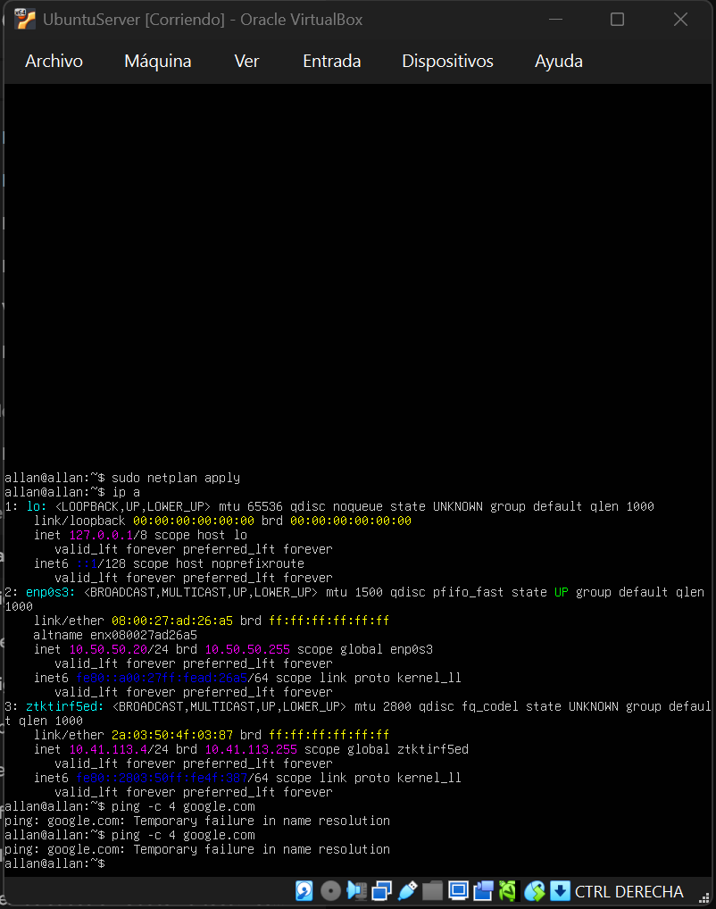

# Tarea 03 - Modos de Red en Máquinas Virtuales

En esta entrega se demuestra la configuración de red de una máquina virtual (hostname: `allan`) operando en modo Bridge bajo tres escenarios distintos de asignación de IP, así como la verificación de salida a internet mediante ping a Google.com.

## Subred del Hipervisor
Para validar las asignaciones de IP, a continuación se presenta la configuración de red del hipervisor (máquina física), estableciendo la subred base de la red local.

---

## Escenario 1: Modo Bridge por DHCP
La máquina virtual obtuvo su dirección IP de forma dinámica a través del servidor DHCP de la red local. Se comprueba la conexión a internet de forma exitosa.

---

## Escenario 2: Modo Bridge con IP Manual (Dentro de la subred)
Se asignó una dirección IP estática dentro de la misma subred del hipervisor modificando el archivo de configuración de Netplan, definiendo correctamente la dirección, el Gateway y los servidores DNS.

**Archivo de configuración (Netplan):**

**Verificación de IP y prueba de Ping:**
Al aplicar los cambios, el equipo toma la IP asignada y el ping hacia Google.com es exitoso, confirmando el correcto enrutamiento y salida a internet.

---

## Escenario 3: Modo Bridge con IP Manual (Fuera de la subred)
Se configuró una IP estática asignando un segmento de red totalmente diferente y ficticio en comparación con la red del hipervisor.

**Archivo de configuración (Netplan):**

**Verificación de IP y prueba de Ping:**
Como resultado esperado, al asignar una IP fuera de la subred física y establecer un Gateway inalcanzable, el equipo pierde el enrutamiento hacia el exterior. La ejecución del ping a Google.com no tiene éxito, comprobando el aislamiento de la red.

