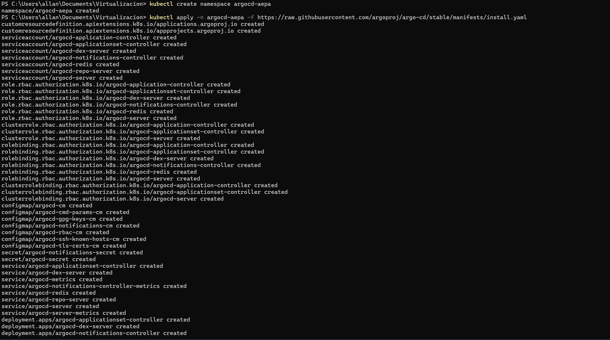
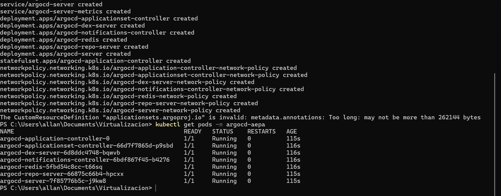
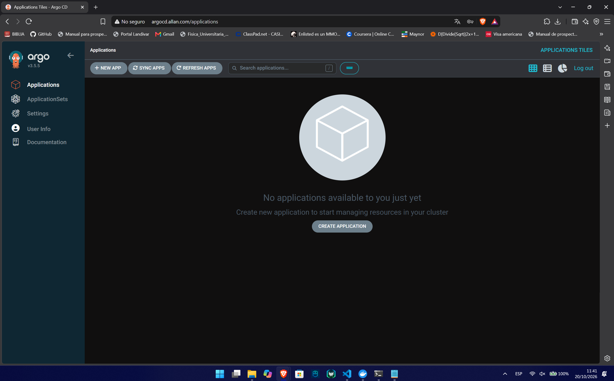
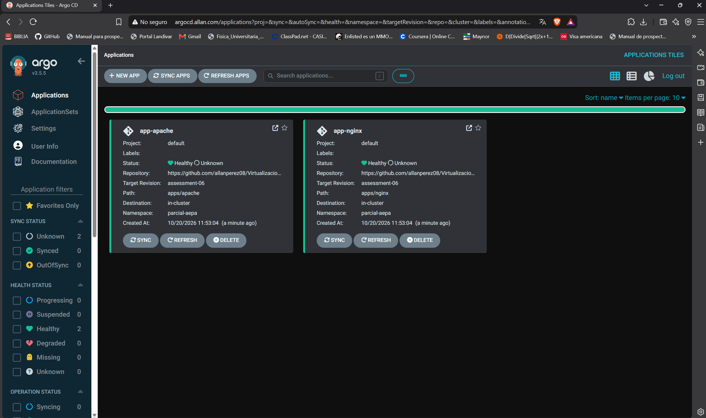
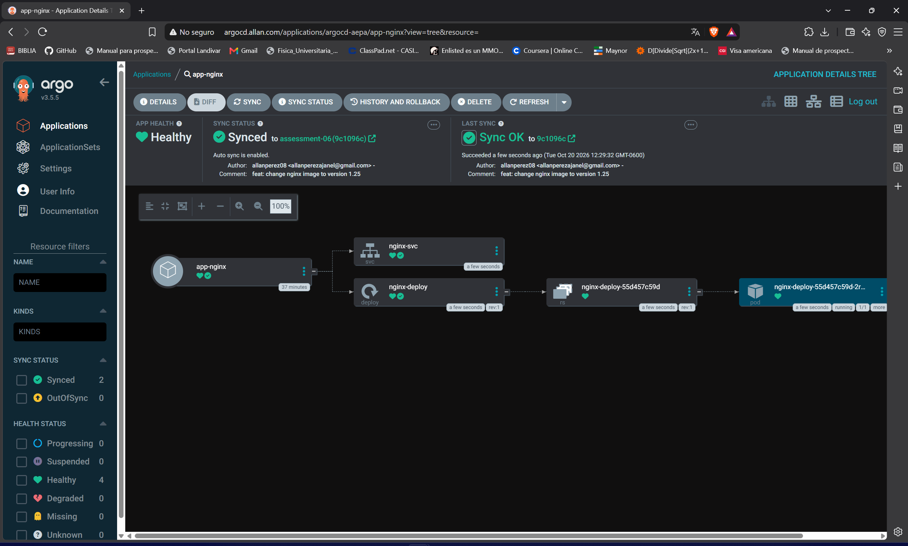

# Virtualizaci# Evaluación Parcial 06 - GitOps con Argo CD y Traefik

En esta evaluación se implementó un flujo completo de GitOps. Se instaló Argo CD en el clúster de Minikube, se expuso su interfaz web mediante Traefik Ingress, y se automatizó el despliegue de aplicaciones web sincronizando directamente los manifiestos alojados en GitHub.

## 1. Instalación de Argo CD
Se creó el namespace personalizado `argocd-aepa` y se aplicaron los manifiestos oficiales de instalación de Argo CD. Adicionalmente, se configuraron los permisos RBAC (ClusterRoleBindings) necesarios para permitir la gestión de recursos a nivel de clúster.

**Despliegue de los recursos base:**

**Verificación de los Pods en ejecución:**

## 2. Exposición mediante Traefik
Para acceder a la interfaz gráfica, se deshabilitó el TLS interno del servidor de Argo CD (mediante patch `--insecure`) y se creó un objeto `IngressRoute` de Traefik apuntando al servicio interno.
Se configuró el archivo `/etc/hosts` (Hosts de Windows) añadiendo el dominio local `argocd.allan.com`. 

A continuación, la evidencia del acceso mediante el navegador:

## 3. Creación de las Applications (Antes del cambio)
A través de Infraestructura como Código (IaC), se definieron dos recursos de tipo `Application` apuntando a las carpetas `apps/nginx` y `apps/apache` de la rama `assessment-06` de este repositorio. Las aplicaciones se desplegaron en el namespace `parcial-aepa`.

Ambas aplicaciones se sincronizaron de forma automática (`selfHeal: true`, `prune: true`), reflejando un estado **Synced** y **Healthy**:

## 4. Sincronización de un cambio en el repositorio (Después del cambio)
Para demostrar el enfoque GitOps de despliegue continuo, se realizó una actualización en el manifiesto `nginx.yaml` dentro del repositorio, modificando la imagen del contenedor de `nginx:1.24` a la nueva versión `nginx:1.25`.

Argo CD detectó el nuevo commit en GitHub y sincronizó automáticamente el estado deseado en el clúster de Kubernetes, actualizando el Pod sin intervención manual.

Evidencia de la aplicación Nginx sincronizada exitosamente reflejando el cambio de configuración:
