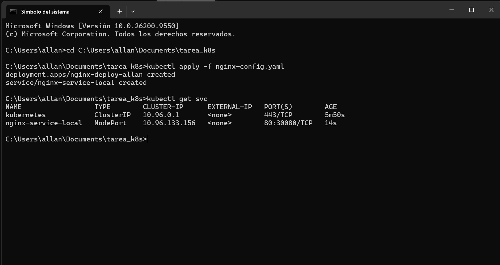
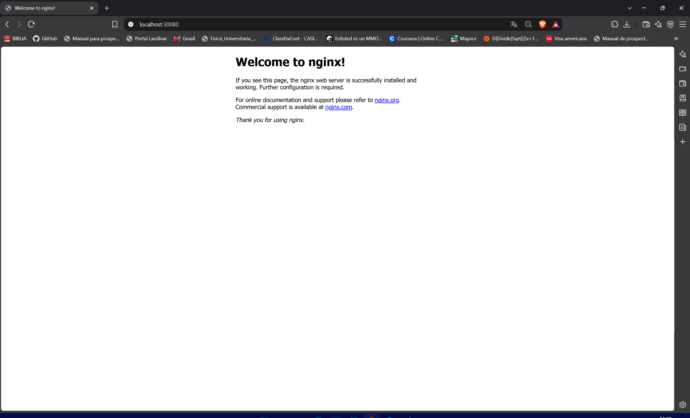

# Tarea 05 - Configuración de Servicio en Kubernetes (Nginx)

En esta actividad se demuestra el despliegue de un servidor Nginx en Kubernetes, exportando su puerto mediante un servicio de tipo NodePort configurado mediante Infraestructura como Código (IaC) para permitir el acceso desde el entorno local.

## 1. Configuración de Servicio utilizando IaC
El servicio fue desplegado exitosamente utilizando el archivo YAML de configuración adjunto en el repositorio. A continuación se presenta la salida del comando `kubectl get svc` dentro del namespace default, verificando la exportación del puerto al entorno local (puerto 30080):

## 2. Llamada desde el navegador hacia el servicio Nginx
Comprobación de la conectividad y exportación correcta del puerto accediendo al servicio a través de `http://localhost:30080` desde la máquina host:

