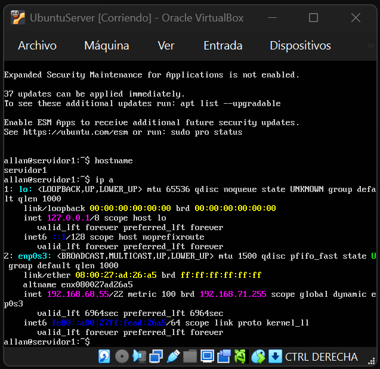
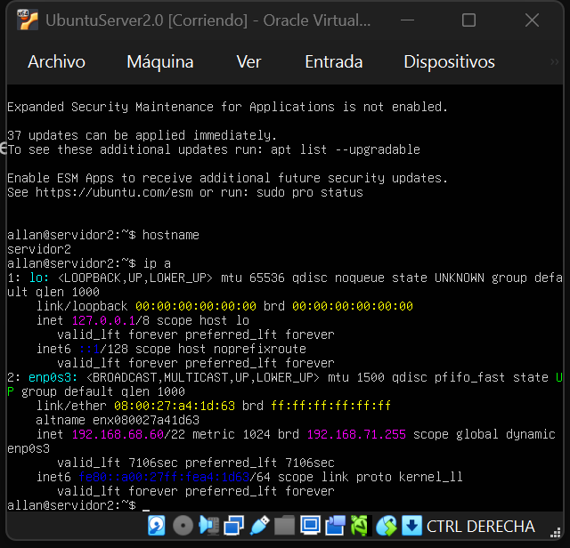
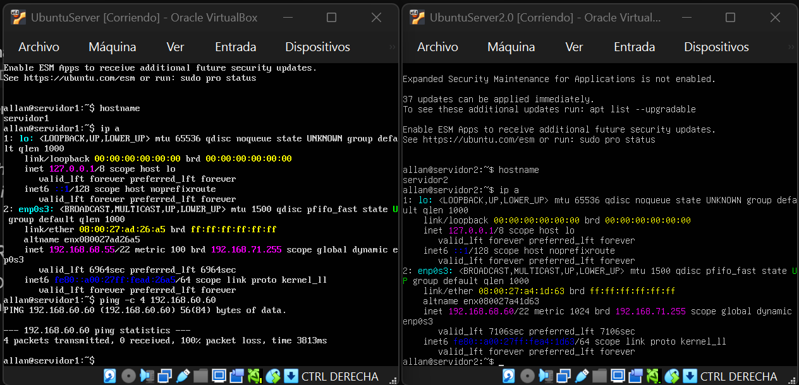

# Tarea 02 - Comunicación entre Servidores Virtuales

A continuación se presentan las evidencias de la configuración de red, cambio de hostname y la comunicación entre dos servidores virtuales (Ubuntu Server).

## 1. Configuración del Servidor Virtual 1
Se configuró el hostname como `servidor1` y se le asignó una IP dentro de la subred local mediante Adaptador Puente.

## 2. Configuración del Servidor Virtual 2
Se configuró el hostname como `servidor2` y obtuvo su respectiva IP en la misma subred.

## 3. Prueba de comunicación (Ping)
Prueba de ping realizada desde el `servidor1` hacia la dirección IP del `servidor2`, demostrando comunicación exitosa entre ambas máquinas virtuales.

