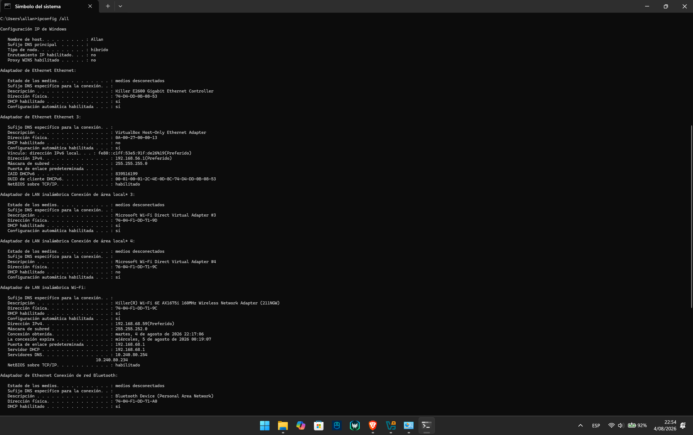
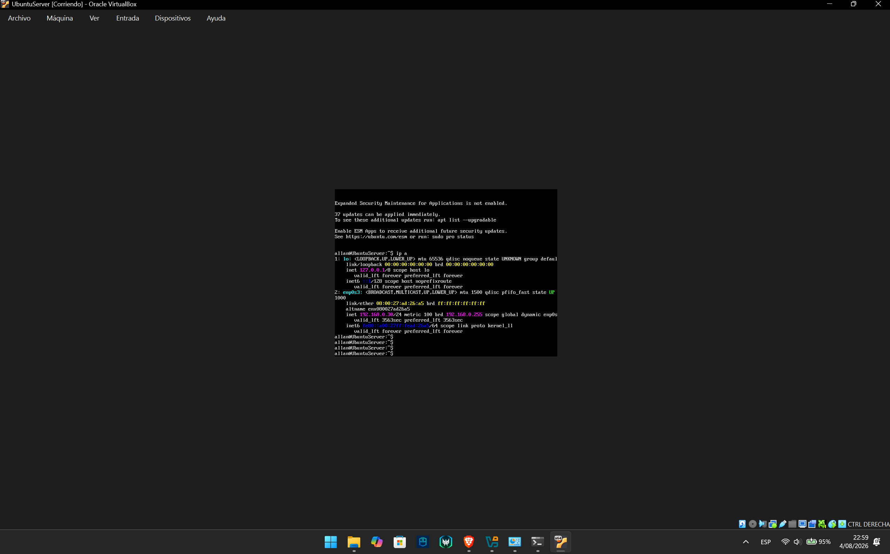
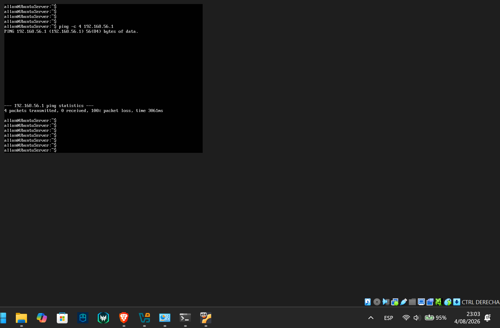

# Tarea 01 - Comunicación Host Local y Host Virtual

A continuación se presentan las evidencias de la configuración de red y la comunicación entre la máquina física y el servidor virtualizado.

## 1. Configuración de red del Host Local (Windows)
En esta captura se aprecia la configuración de red de la máquina física, perteneciendo a la subred local.

## 2. Configuración de red del Host Virtual (Ubuntu Server)
El servidor virtual fue configurado en modo Adaptador Puente, obteniendo una IP de la misma subred que el host local.

## 3. Prueba de comunicación (Ping)
Prueba de ping realizada desde el servidor Ubuntu hacia la máquina Windows, demostrando una conexión exitosa.

