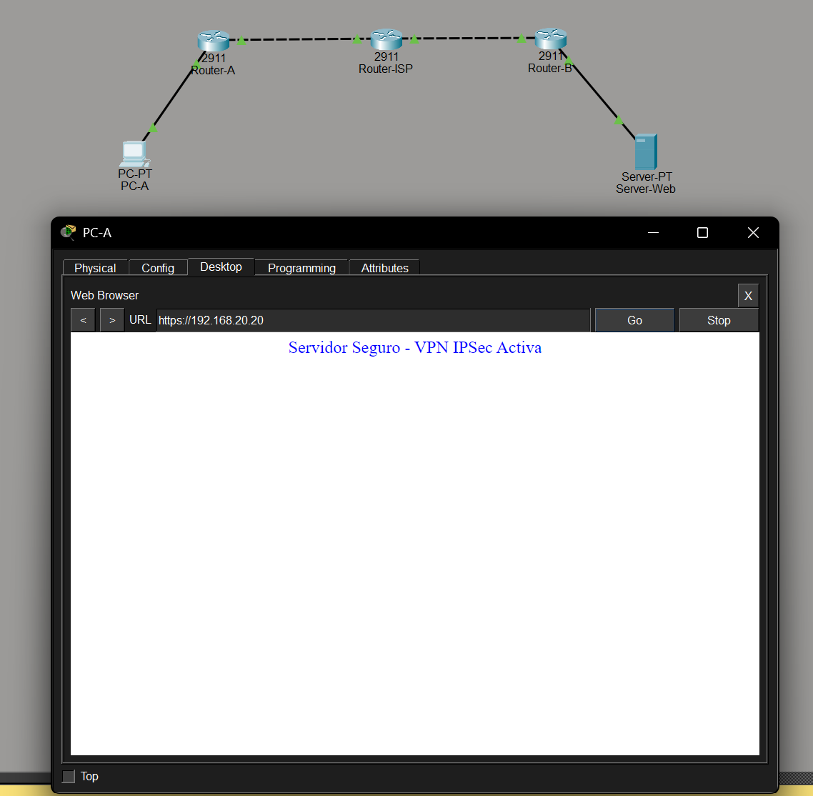

# Tarea 04 - Túnel IPSec (Tunnel Mode) con Servidor HTTPS

En esta actividad se presenta la configuración de una conexión VPN IPSec operando en modo túnel. La topología está compuesta por dos redes de área local con subredes distintas, interconectadas a través de un entorno que simula Internet mediante routers con identificadores claros.

## Topología de Red y Configuración
- **Router-A (Sitio 1):** Protege la subred local `192.168.10.0/24`.
- **Router-ISP:** Simula la infraestructura de Internet. No contiene rutas hacia las subredes LAN, obligando al tráfico a viajar cifrado por la VPN.
- **Router-B (Sitio 2):** Protege la subred local `192.168.20.0/24`, donde se aloja el servidor web.
- **Protocolo de Seguridad:** Se configuró IKE Fase 1 (ISAKMP) y Fase 2 (Transform-Set) forzando explícitamente el `mode tunnel`.

## Entregable: Archivo de Packet Tracer
El archivo de configuración y simulación de la red se encuentra adjunto en este repositorio:
[Descargar Topologia_IPSec.pkt](./Topologia_IPSec.pkt)

## Prueba de Comunicación (Llamada HTTPS)
Se configuró un servidor web en la red remota (IP: `192.168.20.20`) con el servicio HTTPS habilitado. 

Desde la computadora de la red origen (IP: `192.168.10.10`), se realizó una llamada exitosa al servidor mediante el navegador web de la PC usando el protocolo HTTPS. El túnel IPSec se levanta al detectar el tráfico interesante (definido en las ACL) y permite el flujo de datos cifrados de extremo a extremo.

A continuación, se adjunta la captura de pantalla evidenciando la solicitud enviada hacia la IP del servidor y la respuesta del servicio web:

