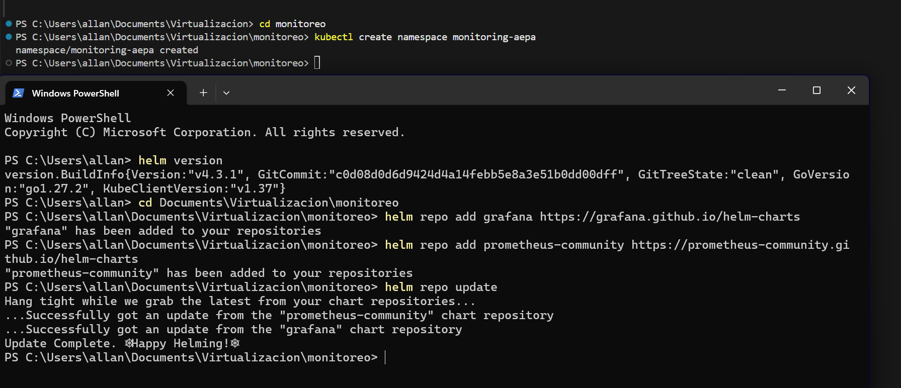
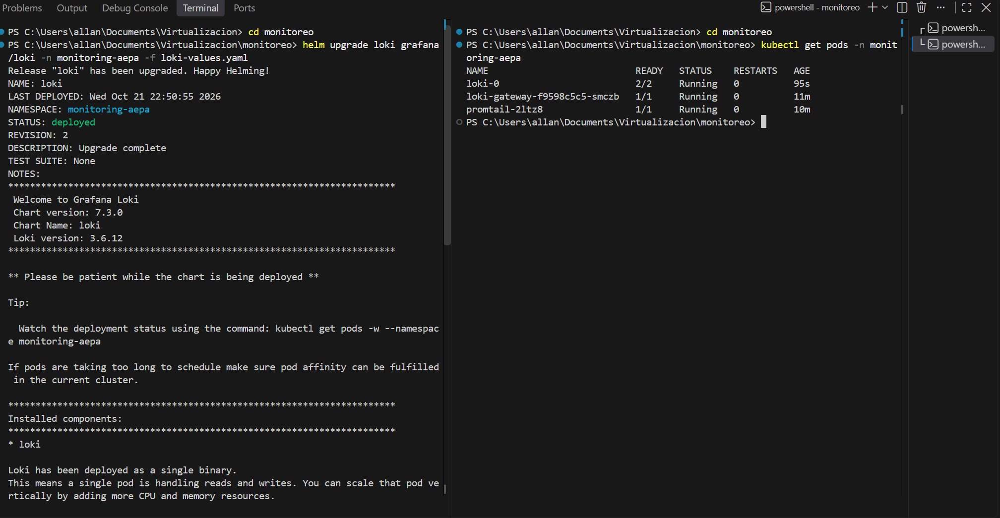
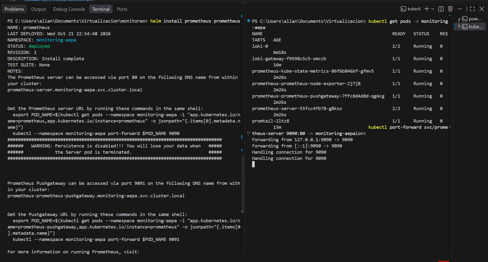
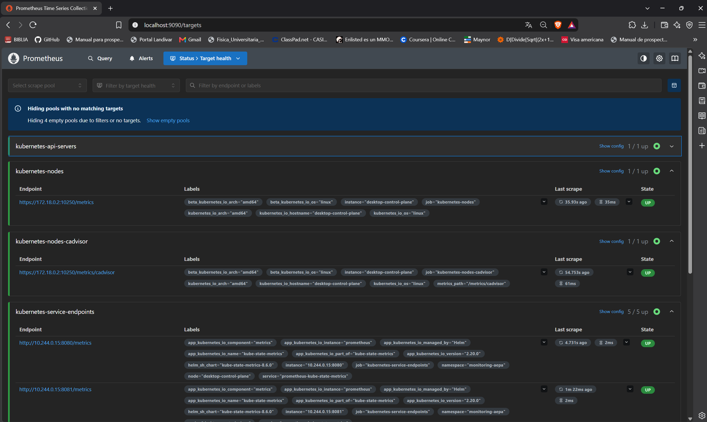
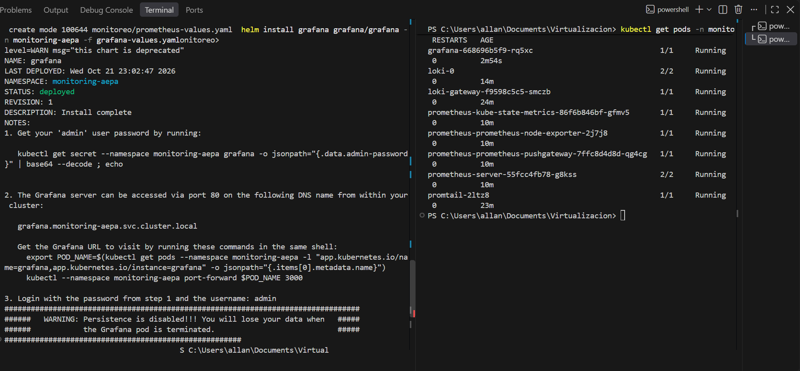
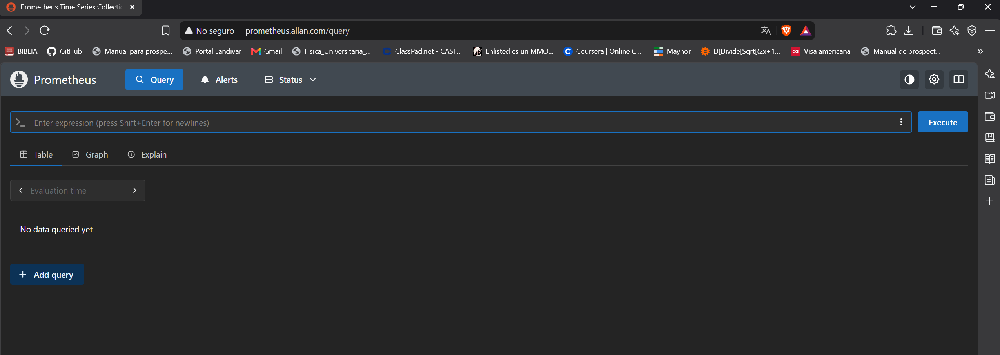
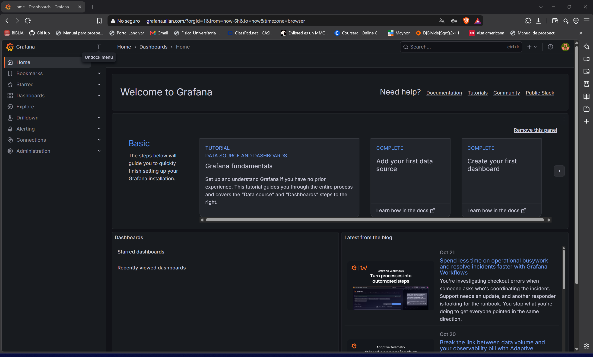
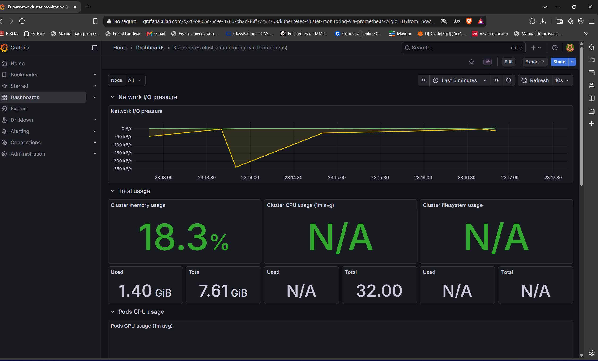
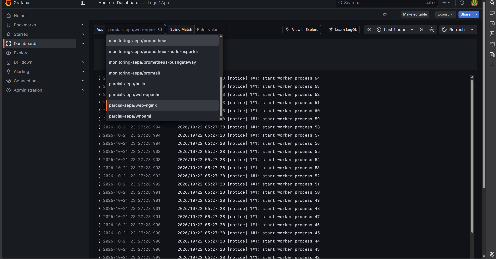

# Proyecto Personal 01 - Sistema de Monitoreo y Centralización de Logs en Kubernetes

En este proyecto se implementó un stack completo de observabilidad (Prometheus, Promtail, Loki y Grafana) dentro de un clúster de Minikube. Toda la configuración se manejó bajo el enfoque de **Infraestructura como Código (IaC)**, utilizando archivos `values.yaml` para personalizar las instalaciones vía Helm, así como manifiestos YAML para el enrutamiento.

Todos los componentes residen en el namespace dedicado `monitoring-aepa`.

---

## 1. Instalación y Configuración del Stack de Monitoreo

### A. Preparación del Entorno
Se creó el namespace `monitoring-aepa` y se agregaron los repositorios oficiales de la comunidad de Grafana y Prometheus en Helm.

### B. Almacenamiento y Recolección de Logs (Loki y Promtail)
- **Loki:** Se instaló utilizando el archivo `monitoreo/loki-values.yaml`. Se configuró en modo `SingleBinary` con el esquema de prueba habilitado (`useTestSchema: true`) y los componentes de caché desactivados para optimizar el rendimiento en Minikube.
- **Promtail:** Se desplegó como `DaemonSet` utilizando `monitoreo/promtail-values.yaml`. Se configuró para recolectar los logs de todos los contenedores del clúster y enviarlos al endpoint interno de Loki. Esta configuración garantiza la recolección de los logs de las 4 aplicaciones del namespace `parcial-aepa` (Nginx, Apache, Whoami, Hello) y del servicio de **Traefik**, cumpliendo con los requerimientos mínimos.

### C. Recolección de Métricas (Prometheus)
Se instaló Prometheus mediante el archivo `monitoreo/prometheus-values.yaml`. Se ajustó la configuración para recolectar las métricas del clúster activando `kube-state-metrics` y `prometheus-node-exporter`, mientras que servicios innecesarios para este entorno (como Alertmanager y persistencia de disco) fueron desactivados.

Para verificar el correcto funcionamiento, se accedió a la interfaz web verificando que los Targets de recolección se encuentran en estado **UP**:

---

## 2. Configuración de Grafana (Provisioning como IaC)

La instalación de Grafana se realizó de forma 100% automatizada a través del archivo `monitoreo/grafana-values.yaml`. No se realizaron configuraciones manuales en la interfaz gráfica.

Mediante código (Provisioning), se inyectó la siguiente configuración:
- **Data Sources:** Se declararon las conexiones internas hacia Prometheus (`http://prometheus-server...`) y Loki (`http://loki-gateway...`).
- **Dashboards:** Se automatizó la descarga y configuración de los JSON de los dashboards utilizando sus identificadores de la comunidad (`gnetId: 315` para métricas y `gnetId: 13639` para logs), enlazándolos directamente a los Data Sources provisionados.

---

## 3. Exposición de Servicios y DNS Local

Para acceder gráficamente a Prometheus y Grafana, se crearon objetos de tipo `IngressRoute` de Traefik definidos en el archivo `monitoreo/monitoring-ingress.yaml`, enrutando el tráfico desde los dominios locales. Adicionalmente, se actualizó el archivo de resolución DNS local (`C:\Windows\System32\drivers\etc\hosts`) apuntando a la IP proveída por el LoadBalancer (MetalLB).

**Acceso a Prometheus Web (`prometheus.allan.com`):**

**Acceso a Grafana Web (`grafana.allan.com`):**

---

## 4. Visualización de Dashboards

**Métricas del Clúster:**
El dashboard aprovisionado por IaC consulta a Prometheus para visualizar exitosamente el uso de CPU, Memoria e I/O de red de los distintos Pods y nodos del clúster.

**Logs Centralizados (Las 4 Aplicaciones):**
El dashboard de Loki refleja el tráfico de logs en tiempo real. Mediante los filtros de etiquetas, se aislaron exitosamente los registros de las 4 aplicaciones desplegadas en el namespace `parcial-aepa` (`web-nginx`, `web-apache`, `whoami`, `hello`), confirmando la correcta recolección por parte de Promtail.
